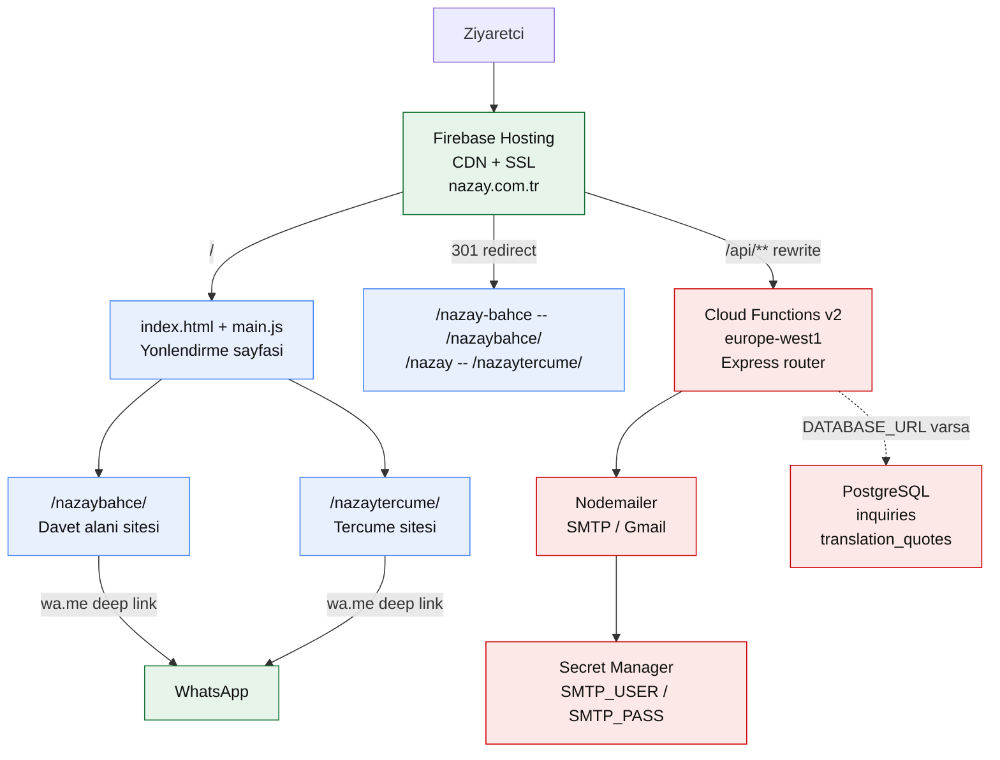
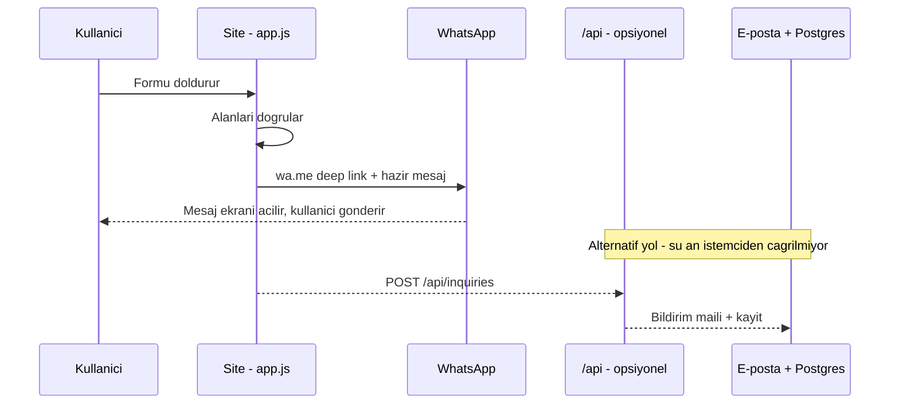

# Nazay — Bahçe & Tercüme

Tek depo, tek alan adı, **iki ayrı web sitesi**. [nazay.com.tr](https://nazay.com.tr) kökünde bir
yönlendirme sayfası durur; ziyaretçi buradan iki işletmeden birini seçer.

| Site | Yol | İşletme | Ne yapar |
|---|---|---|---|
| **Nazay Bahçe** | `/nazaybahce/` | Üsküdar'da butik davet alanı | Nişan, kına, söz ve iftar organizasyonları için mekân tanıtımı, galeri, tarih/fiyat talebi |
| **Nazay Tercüme** | `/nazaytercume/` | Yeminli tercüme bürosu | Noter, apostil ve konsolosluk işlemleri için çeviri hizmetleri, teklif formu, TR/EN/AR dil desteği |

Her iki site de **framework kullanmadan** yazılmıştır: vanilla HTML + CSS + JavaScript.
Build adımı, bundler ve frontend bağımlılığı yoktur — dosyalar olduğu gibi yayınlanır.

---

## Mimari



**Önemli ayrım:** statik dosyalar (HTML, CSS, görsel, video) Cloud Functions'a hiç uğramaz;
Hosting kendi CDN'inden dağıtır. Fonksiyon yalnızca `/api/**` isteklerini karşılar — bu sayede
soğuk başlangıç ve maliyet düşük kalır.

### Form akışı

Formlar şu an **sunucuya gitmez**: istemci tarafında yapılandırılmış bir WhatsApp mesajına
dönüştürülüp `wa.me` üzerinden açılır. Böylece e-posta teslim riski ve spam yükü ortadan kalkar.
API uç noktaları hazır durur ve istenirse devreye alınabilir.



---

## Kullanılan teknolojiler

### Frontend

| Teknoloji | Nerede | Niçin |
|---|---|---|
| Vanilla JS (ES6+) | `main.js`, `*/app.js` | Framework yükü olmadan tab, lightbox, akordiyon, slider, drawer menü |
| CSS Custom Properties | `style.css`, `*/styles.css` | Renk / tipografi / boşluk token'ları tek yerde |
| Google Fonts | Inter + Outfit | Gövde ve başlık ayrımı |
| Font Awesome (cdnjs) | Tercüme sitesi | İkonlar |
| Kendi SVG ikonları | `main.js` | Yönlendirme sayfasında harici ikon kütüphanesi yüklememek için |
| JSON-LD (schema.org) | Her iki `index.html` | `LocalBusiness` yapılandırılmış veri — Google'da zengin sonuç |
| Google Analytics 4 | Tercüme sitesi | `data-track` özniteliğiyle tıklama olayları |
| Kendi i18n katmanı | `nazaytercume/i18n.js` | `data-i18n` öznitelikleriyle TR / EN / AR; ~790 satır sözlük, kütüphane yok |

### Backend

| Teknoloji | Nerede | Niçin |
|---|---|---|
| Firebase Hosting | `firebase.json` | CDN, SSL, 301 yönlendirmeler, cache header'ları |
| Cloud Functions v2 | `functions/index.js` | `/api/**` uç noktaları, `europe-west1`, `maxInstances: 10` maliyet tavanı |
| Express Router | `functions/api.js` | Tek iş mantığı — hem canlıda hem yerelde aynı dosya kullanılır |
| Nodemailer | `functions/api.js` | Form bildirim e-postaları (SMTP) |
| PostgreSQL (`pg`) | `functions/api.js` | Opsiyonel kalıcı kayıt; `DATABASE_URL` yoksa modül hiç yüklenmez |
| Secret Manager | `defineSecret` | `SMTP_USER` / `SMTP_PASS` kodda ve `.env` dosyasında tutulmaz |
| Express (yerel) | `server.js` | `node server.js` ile tek parça yerel sunucu |

### Performans ve SEO yapılandırması

- **Cache-Control:** görsel/video 30 gün, CSS/JS 1 gün, HTML `must-revalidate`
- **Hosting ignore:** ham galeri fotoğrafları (`DSC0*`, `NAZ0*`, `IMG-2025*`, `WhatsApp Image*`) yayına çıkmaz — sitede optimize edilmiş kopyalar kullanılır
- `robots.txt` + `sitemap.xml` kökte
- Her sayfada `canonical`, Open Graph ve Twitter Card etiketleri

---

## Depo yapısı

```
.
├── index.html            # Yönlendirme sayfası (iki panel)
├── main.js               # Panel bileşenleri, SVG ikonlar
├── style.css             # Yönlendirme sayfası stilleri
├── firebase.json         # Hosting + redirects + rewrites + cache + functions
├── .firebaserc           # Firebase proje kimliği
├── server.js             # YEREL geliştirme sunucusu (canlıda kullanılmaz)
│
├── nazaybahce/           # Davet alanı sitesi
│   ├── index.html        # 893 satır — hero, mekânlar, galeri, SSS, iletişim
│   ├── app.js            # Drawer, mekân tabları, galeri filtresi + lightbox,
│   │                     #   SSS akordiyonu, WhatsApp mesaj üretici, slider
│   ├── styles.css
│   └── foto/             # Galeri görselleri + tanıtım videosu
│
├── nazaytercume/         # Tercüme sitesi
│   ├── index.html        # 1238 satır — hizmetler, süreç, teklif formu
│   ├── app.js            # Dil değiştirici, yüzen WhatsApp, teklif formu, GA4 olayları
│   ├── i18n.js           # TR / EN / AR sözlükleri
│   ├── styles.css
│   ├── hizmetler/        # Hizmet detay sayfaları (diploma, pasaport, vekaletname)
│   └── kvkk.html         # KVKK aydınlatma metni
│
├── functions/            # Cloud Functions
│   ├── index.js          # Giriş noktası, secret tanımları, bölge ve limit ayarları
│   └── api.js            # Ortak Express router (canlı + yerel aynı kod)
│
└── portfolio-video/      # Tanıtım videosu üretim hattı (siteden bağımsız)
    ├── capture.cjs       # Playwright ile masaüstü/mobil ekran kaydı
    ├── render.py         # Pillow + NumPy + FFmpeg ile 1080x1920 montaj
    └── README.md         # Ayrıntılı kullanım
```

---

## Yerel çalıştırma

```bash
npm install
node server.js
```

`http://localhost:3000` — statik dosyalar ve `/api` uç noktaları tek sunucudan gelir.

Formların e-posta göndermesi gerekiyorsa kök dizine `.env` ekleyin:

```
SMTP_USER=...
SMTP_PASS=...          # Google "Uygulama Şifresi" — normal Gmail şifresi DEĞİL
MAIL_TO=...            # opsiyonel, boşsa SMTP_USER kullanılır
DATABASE_URL=...       # opsiyonel, tanımlıysa talepler Postgres'e de yazılır
```

Firebase emülatörleriyle canlıya en yakın ortam:

```bash
firebase emulators:start
```

Hosting `:5000`, functions `:5001` portlarında açılır.

## Yayına alma

```bash
firebase deploy
```

Yalnızca bir tarafı güncellemek için:

```bash
firebase deploy --only hosting
```

```bash
firebase deploy --only functions
```

Secret tanımlama (bir kez yeterli):

```bash
firebase functions:secrets:set SMTP_USER
```

## API uç noktaları

| Metot | Yol | Gövde | Ne yapar |
|---|---|---|---|
| `POST` | `/api/inquiries` | isim, telefon, tarih, kişi sayısı, mesaj | Bahçe rezervasyon talebi — bildirim maili, `inquiries` tablosuna kayıt |
| `POST` | `/api/translation-quotes` | isim, iletişim, belge türü, dil çifti, aciliyet | Tercüme teklif talebi — bildirim maili, `translation_quotes` tablosuna kayıt |

Tablolar ilk istekte `CREATE TABLE IF NOT EXISTS` ile oluşturulur.

---

## Bilinen eksikler

- `nazaytercume/index.html` içindeki GA4 ölçüm kimliği hâlâ `G-XXXXXXXXXX` placeholder'ı — gerçek kimlikle değiştirilmeli
- `nazaybahce` tarafında analitik kurulu değil
- Formlar yalnızca WhatsApp üzerinden ilerliyor; `/api` uç noktaları yazılmış ama istemciden çağrılmıyor
- Galeri görselleri ham boyutta (`.JPG`, birkaç MB) — WebP'ye dönüştürülüp Hosting ignore listesi sadeleştirilebilir
